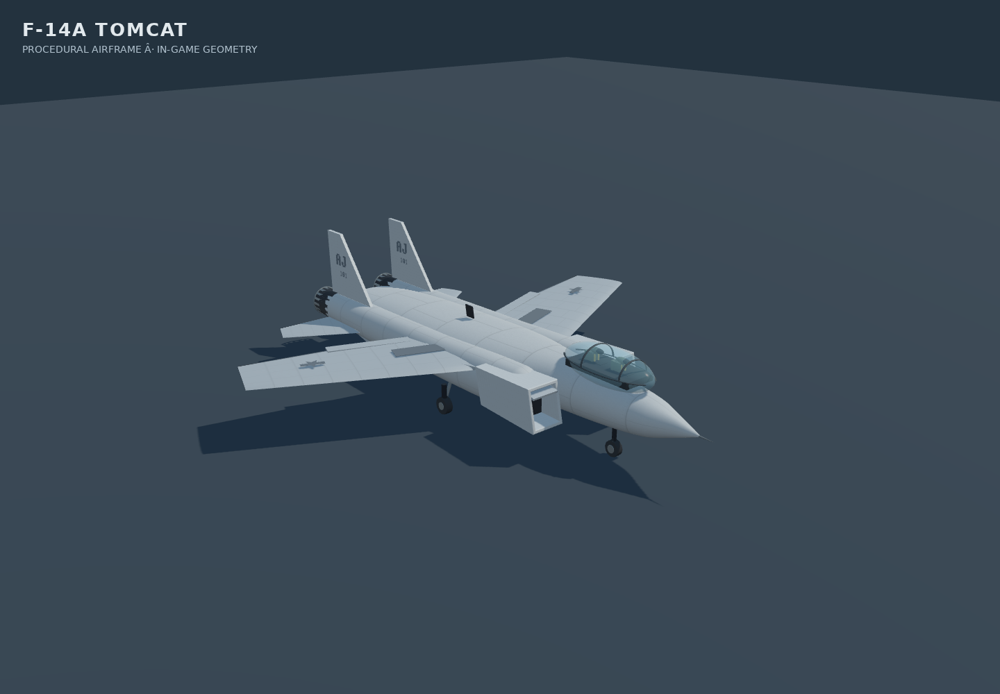

# F-14 Carrier Simulator

Current build label: **2.12.0**, adding lightweight flight analytics in Bored's shared Supabase setup.
See [CHANGELOG.md](CHANGELOG.md) for release notes and
[the code history investigation](docs/VERSION-ARCHAEOLOGY.md)
for the earlier development, recovered builds and missing release history.
`package.json` supplies both the in-game badge and the HTML's
`application-version` metadata.

The **current** simulator lives in typed TypeScript/React modules in `src/`.
This source was recovered from the newest feature-complete project
(commit `63a9e17`), not the early F-14-only prototype.

## Run locally

```bash
npm install
npm run dev
```

## Build the same kind of self-contained HTML used by GitHub Pages and the web app

```bash
npm run typecheck
npm run build
```

The Vite build uses **`app/index.html` and `src/main.tsx`** as its entry,
**not** the precompiled `index.html` at the repo root.
`vite-plugin-singlefile` bundles the full source application into one
HTML file at `dist/index.html`. Only after a successful build, the publish
plugin copies it to `index.html` and `isolate/index.html` (for both hosts).
It also refreshes `src/restored/runtime.js` and `runtime.css` as generated
outputs, although those files are **not the build inputs**.

To deploy GitHub Pages from the repository root, commit the updated
`index.html` after building:

```bash
git add index.html isolate/index.html src/restored
git commit -m "Publish TypeScript build"
git push
```

The result preserves the existing *features and deployment format*, but its
HTML need not be byte-for-byte identical to the old build because this source
contains newer fixes and has been rebuilt from source.

Before publishing, run `npm run check:standalone`. It rejects stale version
metadata and mismatched root/isolate builds. Choose a new minor version for
new player-facing features and a patch version for fixes; rebuild after
changing `package.json`.

## Browser performance (v1.1.1)

Aircraft and lamp instances now use camera and shadow-frustum culling. Deck
lights avoid the shadow pass, static world transforms are computed once, and
small scenery is hidden beyond nearby chunks. Combat contacts and terrain
physics remain available at their existing ranges.

Settings → Graphics includes **Adaptive resolution**, enabled by default. It
reduces only the rendered pixel count during sustained slow frames, then
recovers gradually. Disable it to keep the selected resolution fixed. It does
not alter the 120 Hz flight/weapon simulation, host authority or network timers.

Ordinary flight sends poses near 30 Hz; urgent switches and manoeuvres may
send at 60 Hz. Congested links skip superseded motion updates and resume with
the latest pose while combat and room controls remain reliable. Other pilots'
links continue independently. Timestamped adaptive interpolation, angular prediction and bounded gun history
keep rendering smooth without making visual corrections part of gameplay.
See [networking design, benchmarks and limits](docs/MULTIPLAYER-NETWORKING.md).

Run `bun scripts/diag-performance.ts` and `bun scripts/diag-mp-flow.ts` locally
to check rendering policy, sustained send rates and congestion recovery. These
checks are not connected to GitHub Actions.

## Aircraft visuals (v2.11.0)



Fixed-wing aircraft use smooth procedural fuselages, airfoil sections and swept
fins. The Tomcat has separated nacelles and twin exhausts, while the Hornet,
Crusader and Intruder retain their own silhouettes. Reflective canopy glass,
crew seats, panel seams, low-visibility markings, nozzle petals and gear hardware
work without downloaded assets. The Seahawk shares the cockpit and finish pass.

Small hardware is merged by material and hidden at distance. The generated
reflection environment is captured once, with intensity following day/night and
cloud cover. This is an approximate procedural representation, not a scanned
aircraft model or a validated change to flight dynamics.

Run `npm run test:aircraft:visuals` for surface winding, geometry budgets,
rig/material consistency, exhaust alignment, distance detail and resource-lifetime
checks. Run `npm run test:aircraft:browser` with Chromium installed for rendered
views and the actual aircraft-selection-to-flight flow. Set
`F14_CHROMIUM_EXECUTABLE` to use an existing browser; screenshots default to
`/tmp/f14-aircraft-visuals` (`F14_AIRCRAFT_SCREENSHOTS` overrides the folder).

## Source layout

- `src/sim/aircraft.ts` — F-14A, F/A-18C, A-6E
- `src/sim/flight.ts` — aircraft handling, carrier launches and recovery
- `src/sim/dogfight.ts` — bandits, shared host fight, bombs/missiles, strike
- `src/sim/weather.ts` — theatre weather: wind, gust cycle, sea state, visibility
- `src/sim/engine.ts` — flight loop, missions, HUD, chat, world sync
- `src/net/multiplayer.ts` — peer-to-peer rooms, roster, chat, pose exchange
- `src/render/` — terrain, aircraft geometry, remote aircraft, visual effects,
  rain/lightning
- `src/ui/` — HUD, menus, target pod, multiplayer screens
- `src/accounts.ts`, `src/gamestate.ts`, `src/feedback/` — profiles,
  persisted flight preferences, feedback
- `scripts/diag-*.ts` — offline/diagnostic tests (Bun required)

Some cloud and networking functionality depends on external services.
There are no GitHub Actions workflows configured.

## Flight operations update

The home screen starts with Fly Solo, Fly Together and Head-to-head. Solo
sortie setup contains aircraft, mission and launch choices; settings use Flight,
Controls, Graphics, Audio and Interface tabs.

- A pilot who has not picked a callsign yet still gets the whole home board: the
  callsign card is asked for when a launch button is pressed — enter a name or
  take off as a guest — instead of sitting over the menu on the first launch.
- The board is laid out to fit short viewports: below 860, 700 and 560 px of
  height the mark, heading, action rows and nav tighten up step by step, so a
  Chromebook-sized window shows every row without scrolling.
- The Seahawk's controls are its own. **W/S** is the collective lever, the arrow
  pair tilts the disc — up flies the machine forward, down slows it and then
  reverses it — left/right banks, and A/D swing the tail. A held bank carries the
  nose round with the flight path (the fin and tail rotor's job, once there is
  airflow over it), so a banked turn keeps turning instead of sliding sideways.

- Guns assist up to **5° within 1.5 km**, lead relative motion, and use the same
  hit radius as the illuminated gun cue. Aggressors make shorter evasive breaks.
- Where a sortie starts is remembered. Land on a deck (or the shore runway) and
  that becomes the home strip: **REARM & CONTINUE**, `RESTART MISSION`, the pause
  menu's `RESTART FLIGHT` and the next session all launch from the boat you
  actually recovered on, instead of hopping round the fleet. The launch point
  rides in the gamestate, so it survives a reload and a callsign pull on
  another machine.
- Gear/flaps-down approach pitch inputs are gentler. Recoveries tolerate up to
  11 m/s sink, modest lineup errors and early touchdowns that roll into the
  wire area. A missed wire leaves the aircraft controllable for a go-around.
  Runway landings are confirmed after slowing below 12 m/s: idle throttle and
  hold the wheel-brake binding (B by default).
- Bombing keeps **R → slew, then click a target**. The click is the shot:
  dropping out of a slew never fires, so looking around costs nothing and the
  weapon goes to the spot under the cursor rather than wherever the drag
  happened to end. Every later click re-aims the laser and pulls bombs already
  in flight onto the new spot. A shared trajectory predictor checks each click
  and warns without spending a bomb if the spot cannot be reached. The weapon is
  genuinely laser-guided: it steers hard onto the painted spot and every
  correction costs it speed, so the designator's guidance window bounds the shot
  at a few kilometres — inside it the click is hit, past it the store flies
  ballistically and the release is refused. Racks and release cadence stay the
  same.
- Head-to-head uses the existing room codes and PeerJS connection. Open a room,
  have another pilot join, then the host selects Head-to-head and Start Air Battle.
  Pilots spawn airborne apart on **two carriers drawn from the match id** (one
  boat per side, so both ends of the room agree without another packet), have
  five seconds of protection, and respawn three seconds after a death. A death
  costs the hull but **not the ordnance**: only landing re-arms the racks. Incoming tracers and missile plumes are visible, with a missile warning.
  Completed carrier/runway recoveries preserve the current life and score,
  re-arm the racks, and return the aircraft to a launch position. Hull repair
  is confirmed by the host after checking the recovery surface and speed.
  Guns and missiles damage player aircraft; the
  host owns hull, kills, deaths and life numbers. Late arrivals automatically enter the
  active sortie when the host allows it. The host can disable joining after
  launch using the default-on lobby checkbox. Host takeover preserves the scoreboard.
- Strike defaults to **Stop the Convoy**: disable two of three transports
  before arrival. Partial damage slows cargo; destroying the radar doubles
  escort tracking delay. The escort has finite AA bursts with advance warnings.
  A designated ship/carrier is tracked automatically through a salvo.
- Aggressor defaults to **Fleet Defense**: intercept a scout, defend against
  two escorted bomber strikes, and counterattack between them. Bombers release
  guided bombs; friendly-carrier hull matters. Flight-deck suppression stops
  further launches. Empty or damaged escorts withdraw.
- Both modes offer **Endless Practice**. Objectives show arrival/contact estimates,
  role labels, offscreen arrows, and bomber altitude/closure. Success can be
  finished immediately or followed by optional recovery. Debriefs include
  team results, personal ordnance use, and wire/surface recovery bonuses.
- Co-op operations share targets, hull, phase clocks, enemy ammunition, pending
  launches and inbound bombs. Late joiners catch up; host takeover preserves
  progress. Retry keeps the seed/layout but changes the attempt ID to reject
  old packets. Next Operation changes the seed. Recovery repairs and rearms
  without resetting objectives. See [mission rules](docs/MISSION-UPDATE.md).
- **Operation Iron Bastion** is the island strike: a bunker, hardened hangars
  and a fuel depot inside a radar-cued SAM belt and an AAA curtain. Terrain
  masks the radar, and destroying it shortens battery reach and slows lock.
- **Task Force Archon** is a three-stage campaign — island bastion, reinforcement
  convoy, opposing fleet — stepped in order, so clearing the map does not win it.
  A recovery carries the stage, the wrecks and the hull damage to the next sortie.
- **Weather** (Clear, Overcast, Storm) drives the flight model, the sea and the
  renderer from the preset and the world seed, so a room agrees without a packet.
  Damage is flown as asymmetric yaw, lagging controls and a leaking tank,
  Paddles calls and grades every pass, and a **spectator** can watch the room.
- In flight, **O** opens settings without leaving the cockpit, **M** throws up
  the tactical map (the minimap, scaled to fill the view), **P** pings the
  current threat, target or join call, and a spectator moves to its next view
  (pilots, bandits, decks, the LSO platform, free camera) with **N**. **Enter** opens
  the room radio in multiplayer — Enter sends, Escape closes it without pausing.
  The waiting lobby has no chat. O-settings shows the current room code. The green
  angle ladder and the gun cross can each be switched off in Settings →
  Interface for a clean view.
- Trees, rocks and airbase details are procedural. Instanced scenery is split
  into chunks for culling and scaled by graphics quality, with no external assets.

Head-to-head uses client-reported projectile hits with host checks for range,
weapon cadence, duplicates, shield status and life numbers. It is intended for
casual rooms, rather than competitive anti-cheat. Peer-to-peer connectivity
still depends on signalling/STUN (and configured TURN on restrictive networks).

Local diagnostics (Bun required, **not connected to GitHub Actions**):

```bash
npm run test:aim
npm run test:landing
npm run test:bomb-envelope
npm run test:versus
npm run test:battle-recovery
npm run test:settings
npm run test:net-authority
npm run test:mp
npm run test:menu
npm run test:launch
npm run test:iads
npm run test:campaign
npm run test:weather
npm run test:spectate
npm run test:pod-click
npm run check:standalone
```

## Destroyer (beta phase)

Select **DDG DESTROYER — BETA PHASE** in Sortie Setup or the multiplayer vehicle picker. Take station at sea near the selected friendly carrier. Existing aircraft remain available.

- **W/S**: engine order; **A/D**: helm; **B**: brake/stop. Maximum speed is about 31 knots.
- **Arrow keys**: train/elevate the independent rapid-fire gun; **Q**: fire.
- **R**: gun director. Drag or use the arrows to aim; **E** launches VLS at the contact closest to the director within its acquisition cone. Click a surface point to launch a terrain-clearing strike missile. **R/C** leaves the director.
- **Z**: countermeasures. Stop below 4 knots within 1 km of a friendly carrier and hold **Space** for 3 seconds to repair/rearm. Release before another service. All keyboard actions remain rebindable.

Air Defense adapts fleet defense to a naval air-defense station. Naval Strike offers convoy interdiction and coastal bombardment against Iron Bastion. Task Force uses the existing three-stage campaign. Sea Trials is free navigation/weapons practice. Aircraft and destroyers can share co-op rooms. Head-to-head uses the existing equal-hull rules, spawn shield and 12 km missile claim limit; solo/co-op VLS has an 18 km launch limit. In head-to-head, naval service is available only at your assigned starting carrier.

This is an arcade naval beta: simplified buoyancy, propulsion and countermeasures; the deck gun, rather than a full naval weapons suite. Remote hull movement uses the existing timestamped multiplayer transport; remote turret articulation is not transmitted.

Checks: `npm run test:destroyer`, `npm run test:destroyer:regressions` (moving targets, target lives, mixed combat and naval service), `npm run test:destroyer:browser` (install Chromium with Playwright first), plus the existing aircraft, mission and multiplayer checks.
